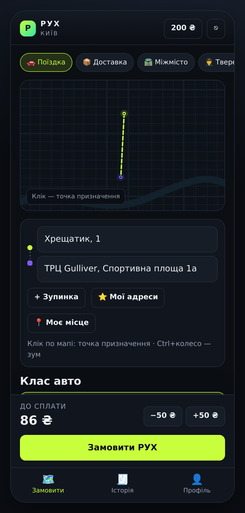
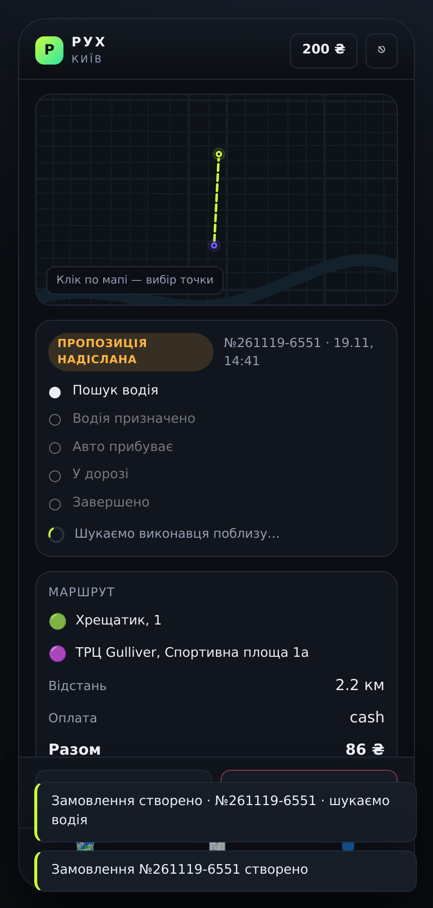
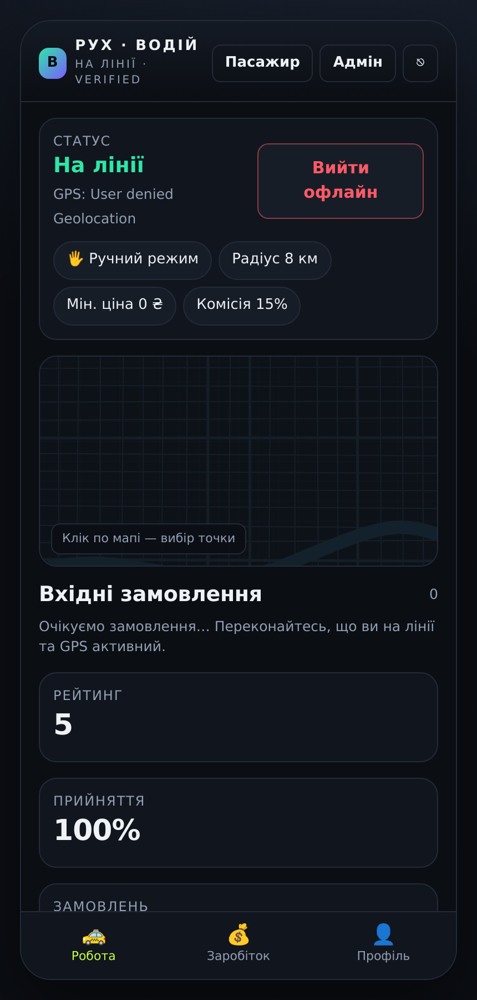
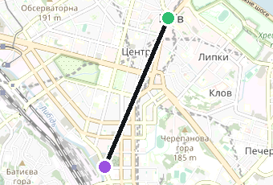
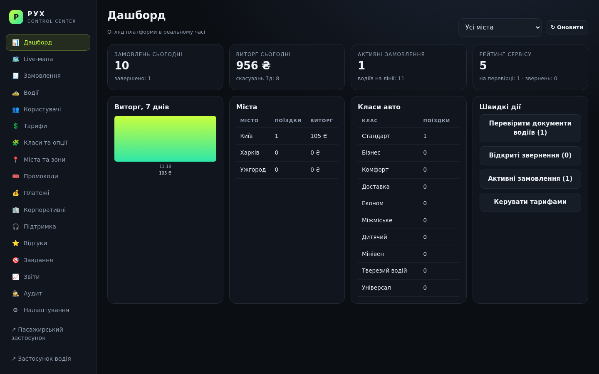
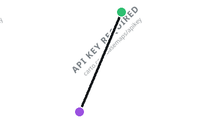
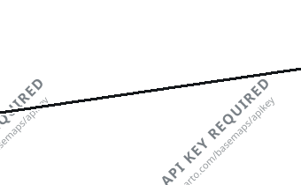

# РУХ (repo: `taxi`) — незалежна платформа таксі, міжміста та доставки

Функціональний реплікат **OnTaxi** (пасажир + водій + диспетчеризація + адмінка) зі своїм брендом,
дизайном і кодом. Не форк, не скрейп, не копія ассетів — уся логіка написана з нуля.

```
Пасажир  →  /            (веб-застосунок, мобільний first)
Водій    →  /driver      (онлайн/офлайн, авто-прийняття, виконання, заробіток)
Адмінка  →  /admin       (17 модулів: live-мапа, тарифи, модерація, фінанси…)
API      →  /api/*       (REST + WebSocket)
```

## Як це виглядає

| Пасажир: замовлення | Пасажир: трекінг | Водій: пропозиції |
|---|---|---|
|  |  |  |

| Мапа в застосунку (стиль OnTaxi) | Адмінка: дашборд | Live-мапа |
|---|---|---|---|
|  |  |  |

| Адмінка: тарифи |
|---|
|---|---|---|
|  |  |  |

### Стиль мапи (світлий, як в OnTaxi)

| маршрут | міжмісто | зум |
| --- | --- | --- |
|  |  |  |

## Android-застосунок (Flutter)

У теці [`mobile/`](mobile/README.md) — справжній Flutter-застосунок пасажира **і** водія
(роль визначає акаунт): OTP-вхід, замовлення з 5 зупинками, класи й живі ціни, опції,
промокоди, «плюс/мінус», попереднє замовлення, доставка посилки, трекінг статусів через
WebSocket, історія, гаманець, підтримка; для водія — онлайн/офлайн, пропозиції з таймером,
просування статусів, заробіток.

- **Готовий APK**: [Releases → android-v0.1.0](../../releases/tag/android-v0.1.0) —
  universal APK (arm64-v8a / armeabi-v7a / x86_64), збирається автоматично у GitHub Actions
  на кожен push у `main`, що змінює `mobile/**` (analyze → test → build → Release).
- **Збірка**: `cd mobile && flutter build apk --release --dart-define=API_BASE_URL=<url-вашого-API>`
- **Демо-сервер для APK**: збірка v0.2.0 за замовчуванням дивиться на публічний
  демо-API (змінна репозиторію `API_BASE_URL`), тому демо-вхід працює одразу після
  встановлення. Адресу можна змінити на екрані входу; для постійного хосту див.
  розділ «Розгортання».
- **Мапа** в застосунку: справжні тайли OpenStreetMap зі світлим фільтром у стилі OnTaxi
  (зелена точка подачі, фіолетова — призначення, бурштинова зупинка, темний маршрут),
  жестова навігація, кеш тайлів у памʼяті. Клієнт не залежить від платних SDK.
- **Адреса API** змінюється і в самому застосунку: екран входу → іконка сервера;
  на екрані входу є індикатор «Сервер доступний / недоступний» із повторною перевіркою.
- Деталі, підпис для Play Store і список обмежень — у [`mobile/README.md`](mobile/README.md).

## Дизайн: палітра OnTaxi

Застосунок переведено зі темної теми на світлу в бренд-кольорах оригінального
OnTaxi (жовтий `#FFD000`, зчитаний із `ontaxi.com.ua`, і чорний `#14171A` на
білих картках).

| Токен | Колір | Використання |
| --- | --- | --- |
| `accent` | `#FFD000` | головні кнопки, активні класи, логотип |
| `ink` | `#14171A` | текст, іконки, текст на жовтому |
| `surface` / `background` | `#FFFFFF` / `#F6F7F9` | картки / фон екрана |
| `surfaceAlt` | `#F1F3F5` | поля вводу, чипи |
| `success` / `warning` / `danger` | `#0B7A48` / `#8F5B00` / `#C9302C` | статуси (затемнені для контрасту) |

Контраст перевіряється тестом (`test/theme_test.dart`): текст на білому й на
жовтому ≥ 4.5:1 (WCAG AA), кольори статусів ≥ 4:1. Макет палітри —
[`docs/screenshots/theme-ontaxi.svg`](docs/screenshots/theme-ontaxi.svg).

## Демо-вхід

На екрані входу — кнопка **«Демо-вхід одним дотиком»**: застосунок сам знаходить
живу адресу API й заходить як пасажир. Нічого вводити не треба.

Як це працює:

1. на старті застосунок читає [`endpoint.json`](endpoint.json) із цього
   репозиторію (стабільне посилання, не залежить від тунелю) і додає адреси до
   списку резервних;
2. `ApiClient` пробує адреси по черзі (мережевий збір або `5xx` → наступна);
3. демо-вхід робить до 3 спроб із паузою 3 с — короткі обриви тунелю не видно.

Тому при зміні тунелю достатньо оновити `endpoint.json` — **APK перезбирати не
потрібно**. Якщо репозиторій зробити приватним, автовиявлення перестане
працювати (raw-файл вимагатиме авторизації) — залишаться адреси, вшиті в APK.

## Розгортання API

`docker-compose.yml` — цільовий стек (Postgres/PostGIS, Redis, RabbitMQ, API).
Швидкий публічний демо-доступ без інфраструктури: тунель до локального сервера

```bash
cloudflared tunnel --url http://127.0.0.1:3000   # отримайте https://<name>.trycloudflare.com
```

Отриману адресу впишіть у *Settings → Secrets and variables → Actions → Variables*
як `API_BASE_URL` — наступна збірка APK ходитиме туди.

**Резервна адреса.** `API_BASE_URL_FALLBACK` (необовʼязкова змінна) — друга адреса
API. Якщо основна не відповідає (мережа, 5xx), `ApiClient` сам перемикається на неї
й далі працює з робочої, тож один впавший тунель не «вбиває» демо.

```bash
# два незалежні тунелі: основний і резервний
cloudflared tunnel --url http://127.0.0.1:3000 --protocol http2   # резервний
```

> Quick tunnel — без гарантій аптайму: адреса ефемерна й вмирає разом із процесом.
> Для постійного хосту: VPS/Render/Railway/Fly з диском під SQLite або Postgres з
> `docs/03-data-model.sql`.

### Варіанти хостингу

Покроково (VPS/Docker, Vercel, локально + тунель, Wi-Fi без інтернету) —
[`docs/06-hosting.md`](docs/06-hosting.md).

### Serverless (Vercel)

```bash
npm install            # esbuild для бандлу
npm run build:vercel   # → api/index.mjs + public/index.html
```

`vercel.json` уже налаштований: `api/index.mjs` — це весь Fastify-API одною
функцією. Сумісність забезпечують:

* `server/src/db/node-sqlite.mjs` — драйвер `better-sqlite3`-API поверх вбудованого
  `node:sqlite` (без нативних модулів; вкладені транзакції через `SAVEPOINT`);
* схема БД інлайниться у бандл (`SCHEMA_SQL`), БД живе у `/tmp` інстансу;
* диспетчер-цикл заміщено опортуністичним тіком на кожному запиті
  (`server/src/vercel.ts`), тобто пропозиції, таймаути й планові замовлення
  працюють і без довгоживучого процесу.

Обмеження demo-режиму на serverless: WebSocket недоступний (клієнти оновлюють
стан опитуванням), стан скидається після зупинки інстансу, а демо-дані
пересіваються на холодному старті.

## Швидкий старт

```bash
cd server
npm install
npm run dev            # http://localhost:3000
npm test               # 37 інтеграційних тестів — усі на реальній БД і HTTP
npm run typecheck
```

Демо-дані створюються автоматично при першому запуску: 3 міста (Київ, Ужгород, Харків),
10 класів авто/послуг, 11 водіїв на лінії, промокоди, корпоративний акаунт, 1 водій на модерації.

Демо-входи (SMS-шлюз не підключений, тому OTP повертається у відповіді API):

| Роль | Телефон |
|---|---|
| Пасажир | `+380671112233` (баланс 200 ₴) |
| Водій (авто-прийняття) | `+380671000101` |
| Водій (ручний режим) | `+380671000102` |
| Диспетчер | `+380500000002` |
| Адміністратор | `+380500000001` |
| Корпоративний адмін | `+380503334455` |

## Що вже працює (перевірено тестами і браузером)

**Пасажир:** OTP-авторизація, геолокація, мапа, пошук адрес, збережені адреси, 5 проміжних зупинок,
фіксована ціна до підтвердження по всіх класах, опції (дитяче крісло, тварина, багаж…), промокоди,
плюс/мінус ціни, коментар, попереднє замовлення, замовлення для іншої людини, оплата (готівка/картка/
Apple Pay/Google Pay/баланс/корпоративна), трекінг у реальному часі по WebSocket, зміна маршруту з
підтвердженням водія, скасування з компенсацією, історія, повтор замовлення, оцінка/відгук, підтримка.

**Водій:** реєстрація з документами й верифікацією, онлайн/офлайн, GPS-трекінг у фоні, вхідні
пропозиції з таймером, **авто-прийняття за власними критеріями** (радіус / мін. ціна / класи),
виконання замовлення по статусах, навігація у зовнішні карти, доставка з кодами підтвердження,
заробіток, баланс і транзакції, виплати, рейтинг, % прийняття, статистика за містами й годинами,
бонусні завдання, підтримка.

**Диспетчеризація:** пошук за радіусом з розширенням по раундах, паралельні пропозиції + таймер,
перепризначення, ручне призначення диспетчером, заборона подвійного призначення (частковий
унікальний індекс + транзакція), автоматичний савеєр і звільнення водіїв.

**Адмінка:** дашборд (KPI, виторг, міста, класи), live-мапа водіїв і замовлень, замовлення
(скасування, повернення, призначення), модерація водіїв, користувачі й ролі, тарифи (усі
коефіцієнти редагуються без коду), класи та опції, міста й геозони, промокоди, платежі й баланси,
корпоративні акаунти, підтримка, відгуки, завдання, звіти CSV, аудит, налаштування диспетчеризації.

### Доопрацювання 0.3.0

* **Фото вручення посилки** — курʼєр фотографує передачу (камера/галерея),
  файл іде на `POST /api/uploads`, пасажир бачить підтвердження в замовленні
  й може збільшити фото.
* **Документи водія** — у застосунку: 5 типів (посвідчення, техпаспорт, фото авто,
  ID-картка, страховка), статус «надіслано/на перевірці», верифікація з адмінки.
* **Переписка з підтримкою** — тред звернення з автооновленням (відповідь агента
  з адмінки зʼявляється без дій користувача).
* **Доставка в застосунку** — коди відправника/отримувача, статуси, ціна, фото.

## Чесний статус відносно OnTaxi

| Область | Стан |
|---|---|
| Доменна логіка (тарифи, диспетчеризація, платежі, доставка, корпоратив) | реалізовано |
| Веб-клієнти пасажира, водія, адмінки | реалізовано, працює в браузері |
| Нативні Flutter-застосунки (iOS/Android) | **не реалізовано** — веб-клієнти адаптивні, PWA-логіка готова до перенесення |
| NestJS/PostgreSQL/PostGIS/Redis/RabbitMQ | логіка модульна й готова до перенесення; поточний рантайм — TS + Fastify + SQLite (див. `docs/02-architecture.md`) |
| Реальні SMS/платежі/карти/FCM | інтерфейси й адаптери є, провайдери — заглушки (демо-режим) |
| Антифрод, SLA, юридичні вимоги, «внутрішня» логіка OnTaxi | **потребує додаткового дослідження**, не видається за відтворене |

Повна матриця функцій: `docs/01-functional-map.md`. План робіт: `docs/05-roadmap.md`.

## Структура

```
taxi/
├── server/                 # API (TypeScript, Fastify, модульна архітектура)
│   ├── src/lib/            # pricing, dispatch, payments, geo, realtime, order-service
│   ├── src/modules/        # auth, orders, driver, admin, corporate, geo, support
│   ├── src/schema.sql      # референсна схема (SQLite); Postgres-версія в docs/
│   └── test/api.test.ts    # 37 інтеграційних тестів
├── web/                    # 3 клієнти (vanilla ES-модулі, без CDN і зборки)
│   └── app/{api,map,passenger,driver,admin}.js
├── docs/                   # функціональна карта, архітектура, модель даних, API, роадмап
└── docker-compose.yml      # цільовий стек: PostgreSQL+PostGIS, Redis, RabbitMQ
```

## Безпека та якість

- Усі грошові операції — ідемпотентні (унікальні ключі в `wallet_transactions`/`payment_intents`).
- Одна поїздка → максимум один водій (частковий унікальний індекс + перевірка в транзакції).
- OTP: TTL, ліміт спроб, ліміт запитів на номер.
- Кожна привілейована дія пише `audit_logs`.
- 37 інтеграційних тестів на реальній БД; `tsc --noEmit` без помилок.

## Ліцензія

Код — ваш. Бренд «РУХ», логотип і дизайн створені для цього проєкту. OnTaxi — чужий бренд,
його назва, логотип і матеріали тут не використовуються.
