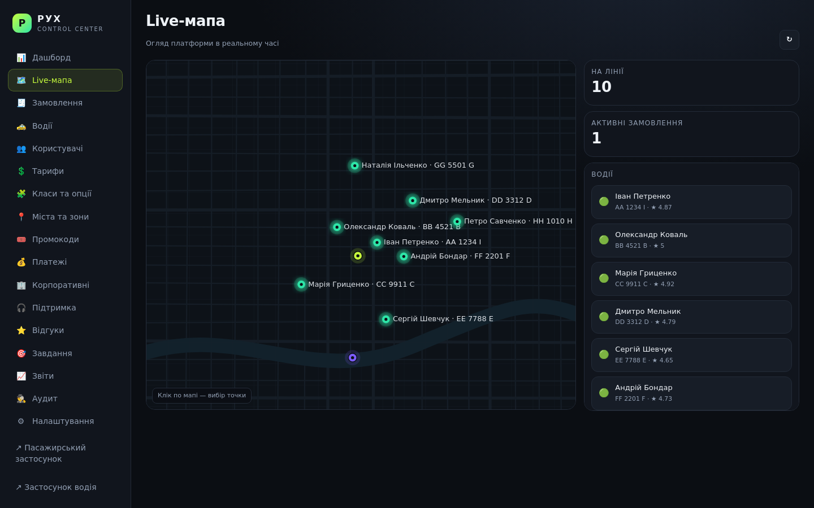
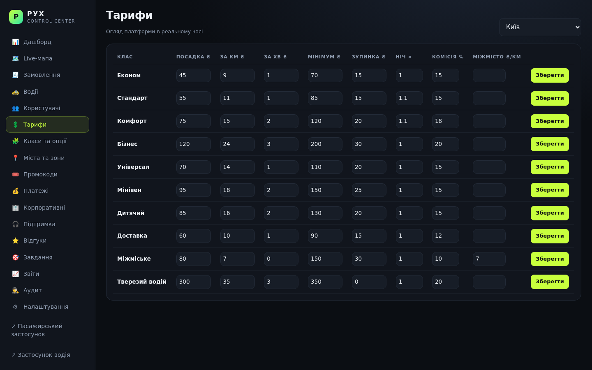

# РУХ (repo: `taxi`) — незалежна платформа таксі, міжміста та доставки

Функціональний реплікат **OnTaxi** (пасажир + водій + диспетчеризація + адмінка) зі своїм брендом,
дизайном і кодом. Не форк, не скрейп, не копія ассетів — уся логіка написана з нуля.

```
Пасажир  →  /            (веб-застосунок, мобільний first)
Водій    →  /driver      (онлайн/офлайн, авто-прийняття, виконання, заробіток)
Адмінка  →  /admin       (17 модулів: live-мапа, тарифи, модерація, фінанси…)
API      →  /api/*       (REST + WebSocket)
```

## Як це виглядає

| Пасажир: замовлення | Пасажир: трекінг | Водій: пропозиції |
|---|---|---|
|  |  |  |

| Адмінка: дашборд | Live-мапа | Тарифи |
|---|---|---|
|  |  |  |

## Android-застосунок (Flutter)

У теці [`mobile/`](mobile/README.md) — справжній Flutter-застосунок пасажира **і** водія
(роль визначає акаунт): OTP-вхід, замовлення з 5 зупинками, класи й живі ціни, опції,
промокоди, «плюс/мінус», попереднє замовлення, доставка посилки, трекінг статусів через
WebSocket, історія, гаманець, підтримка; для водія — онлайн/офлайн, пропозиції з таймером,
просування статусів, заробіток.

- **Готовий APK**: [Releases → android-v0.1.0](../../releases) (збирається автоматично у
  GitHub Actions на кожен push у `main`, що змінює `mobile/**`).
- **Збірка**: `cd mobile && flutter build apk --release --dart-define=API_BASE_URL=<url-вашого-API>`
- **Адреса API** змінюється і в самому застосунку: екран входу → іконка сервера.
- Деталі, підпис для Play Store і список обмежень — у [`mobile/README.md`](mobile/README.md).

## Швидкий старт

```bash
cd server
npm install
npm run dev            # http://localhost:3000
npm test               # 37 інтеграційних тестів — усі на реальній БД і HTTP
npm run typecheck
```

Демо-дані створюються автоматично при першому запуску: 3 міста (Київ, Ужгород, Харків),
10 класів авто/послуг, 11 водіїв на лінії, промокоди, корпоративний акаунт, 1 водій на модерації.

Демо-входи (SMS-шлюз не підключений, тому OTP повертається у відповіді API):

| Роль | Телефон |
|---|---|
| Пасажир | `+380671112233` (баланс 200 ₴) |
| Водій (авто-прийняття) | `+380671000101` |
| Водій (ручний режим) | `+380671000102` |
| Диспетчер | `+380500000002` |
| Адміністратор | `+380500000001` |
| Корпоративний адмін | `+380503334455` |

## Що вже працює (перевірено тестами і браузером)

**Пасажир:** OTP-авторизація, геолокація, мапа, пошук адрес, збережені адреси, 5 проміжних зупинок,
фіксована ціна до підтвердження по всіх класах, опції (дитяче крісло, тварина, багаж…), промокоди,
плюс/мінус ціни, коментар, попереднє замовлення, замовлення для іншої людини, оплата (готівка/картка/
Apple Pay/Google Pay/баланс/корпоративна), трекінг у реальному часі по WebSocket, зміна маршруту з
підтвердженням водія, скасування з компенсацією, історія, повтор замовлення, оцінка/відгук, підтримка.

**Водій:** реєстрація з документами й верифікацією, онлайн/офлайн, GPS-трекінг у фоні, вхідні
пропозиції з таймером, **авто-прийняття за власними критеріями** (радіус / мін. ціна / класи),
виконання замовлення по статусах, навігація у зовнішні карти, доставка з кодами підтвердження,
заробіток, баланс і транзакції, виплати, рейтинг, % прийняття, статистика за містами й годинами,
бонусні завдання, підтримка.

**Диспетчеризація:** пошук за радіусом з розширенням по раундах, паралельні пропозиції + таймер,
перепризначення, ручне призначення диспетчером, заборона подвійного призначення (частковий
унікальний індекс + транзакція), автоматичний савеєр і звільнення водіїв.

**Адмінка:** дашборд (KPI, виторг, міста, класи), live-мапа водіїв і замовлень, замовлення
(скасування, повернення, призначення), модерація водіїв, користувачі й ролі, тарифи (усі
коефіцієнти редагуються без коду), класи та опції, міста й геозони, промокоди, платежі й баланси,
корпоративні акаунти, підтримка, відгуки, завдання, звіти CSV, аудит, налаштування диспетчеризації.

## Чесний статус відносно OnTaxi

| Область | Стан |
|---|---|
| Доменна логіка (тарифи, диспетчеризація, платежі, доставка, корпоратив) | реалізовано |
| Веб-клієнти пасажира, водія, адмінки | реалізовано, працює в браузері |
| Нативні Flutter-застосунки (iOS/Android) | **не реалізовано** — веб-клієнти адаптивні, PWA-логіка готова до перенесення |
| NestJS/PostgreSQL/PostGIS/Redis/RabbitMQ | логіка модульна й готова до перенесення; поточний рантайм — TS + Fastify + SQLite (див. `docs/02-architecture.md`) |
| Реальні SMS/платежі/карти/FCM | інтерфейси й адаптери є, провайдери — заглушки (демо-режим) |
| Антифрод, SLA, юридичні вимоги, «внутрішня» логіка OnTaxi | **потребує додаткового дослідження**, не видається за відтворене |

Повна матриця функцій: `docs/01-functional-map.md`. План робіт: `docs/05-roadmap.md`.

## Структура

```
taxi/
├── server/                 # API (TypeScript, Fastify, модульна архітектура)
│   ├── src/lib/            # pricing, dispatch, payments, geo, realtime, order-service
│   ├── src/modules/        # auth, orders, driver, admin, corporate, geo, support
│   ├── src/schema.sql      # референсна схема (SQLite); Postgres-версія в docs/
│   └── test/api.test.ts    # 37 інтеграційних тестів
├── web/                    # 3 клієнти (vanilla ES-модулі, без CDN і зборки)
│   └── app/{api,map,passenger,driver,admin}.js
├── docs/                   # функціональна карта, архітектура, модель даних, API, роадмап
└── docker-compose.yml      # цільовий стек: PostgreSQL+PostGIS, Redis, RabbitMQ
```

## Безпека та якість

- Усі грошові операції — ідемпотентні (унікальні ключі в `wallet_transactions`/`payment_intents`).
- Одна поїздка → максимум один водій (частковий унікальний індекс + перевірка в транзакції).
- OTP: TTL, ліміт спроб, ліміт запитів на номер.
- Кожна привілейована дія пише `audit_logs`.
- 37 інтеграційних тестів на реальній БД; `tsc --noEmit` без помилок.

## Ліцензія

Код — ваш. Бренд «РУХ», логотип і дизайн створені для цього проєкту. OnTaxi — чужий бренд,
його назва, логотип і матеріали тут не використовуються.
